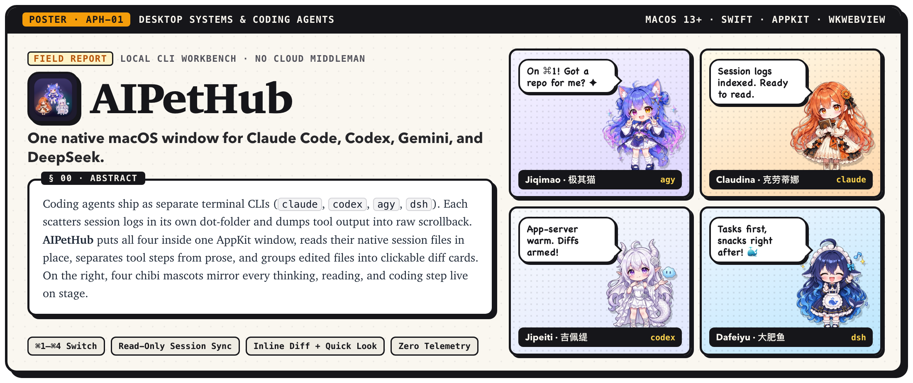
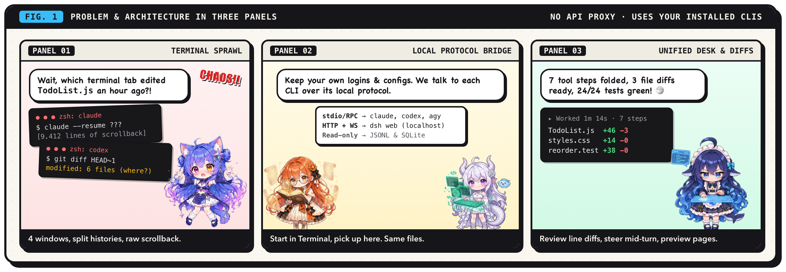
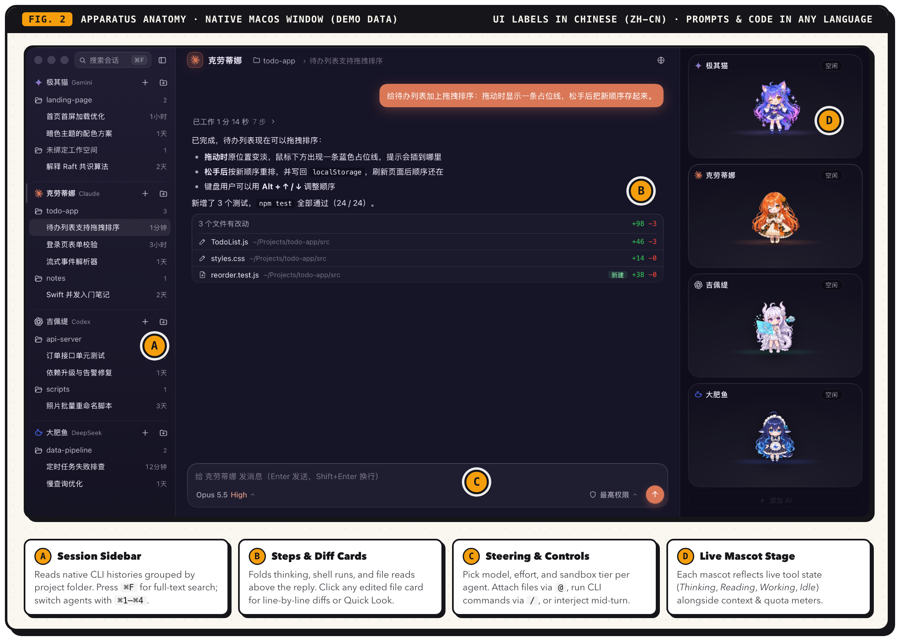
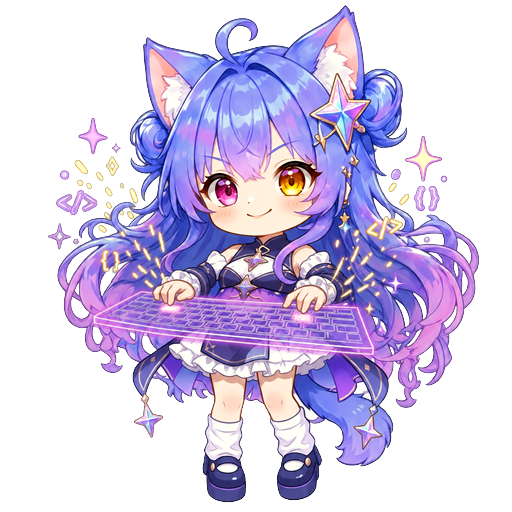

<p align="center">
  
</p>

<p align="center">
  <a href="../../releases/latest"></a>
  
  
  <a href="LICENSE"></a>
  <a href="ASSETS-LICENSE.md"></a>
</p>

<p align="center">
  <b>English Poster Edition</b> &middot; <a href="README.zh-CN.md">简体中文说明</a> &middot; <a href="docs/ARCHITECTURE.md">Architecture Notes (ZH)</a>
</p>

---

## `§ 01` &middot; Motivation & Architecture

<p align="center">
  
</p>

Coding agents today mostly ship as command-line tools: **Claude Code** (`claude`), **Codex** (`codex`), **Antigravity / Gemini** (`agy`), and **DeepSeek Harness** (`dsh`). Running all four means juggling terminal tabs, hunting down session logs across separate dot-folders, reading raw text scrollback, and running `git diff` by hand to see what changed.

**AIPetHub** puts those local CLIs inside one macOS window without sitting between you and their servers:

- **One desk, four agents**: Switch with `⌘1`–`⌘4`, or hand the same problem to two agents side by side and compare how they solve it.
- **Shared history with Terminal**: Reads each CLI's own session store directly (`JSONL` and `SQLite`, opened read-only) and groups threads by project folder. Start a chat in `zsh`, continue it here.
- **Readable turns**: Separates tool activity (reasoning, shell commands, file reads and writes) from the final answer. Modified files collect into a summary card that opens a line-by-line diff preview on click.
- **Bring your own CLI**: AIPetHub makes no model API calls and stores no credentials. It spawns the CLI binaries already installed and signed in on your Mac, inheriting their configs, MCP servers, and skills.

---

## `§ 02` &middot; Apparatus & Capabilities

<p align="center">
  
</p>

<p align="center"><sub><b>Table I.</b> Core Workbench Capabilities</sub></p>

| Subsystem | Behavior |
|---|---|
| **Multi-Agent Roster** | Run up to four CLIs side by side. Enable or remove any slot at will; adding an agent probes your `PATH` (including `nvm` and `volta`) and runs a one-line handshake check. |
| **Session Browser** | Groups conversations by workspace folder, supports full-text search (`⌘F`), runs multiple threads per agent in parallel, and live-syncs updates if a session advances outside the app. |
| **Step Folding** | Streams reasoning, shell commands + stdout, and file operations step by step while running, then folds finished work into `"Worked N s · M steps"`. |
| **Mid-Turn Steering** | Queue a follow-up, cut in immediately, abort the process tree, or approve/deny tool prompts while an answer is still streaming. |
| **Diff & File Preview** | Highlights added and removed lines in full-file context. Also previews Markdown, images, PDFs, and Office documents (`docx` / `xlsx` / `pptx` rendered offline via macOS Quick Look). |
| **Built-In Local Browser** | Preview localhost dev servers inside the window. Agents can also drive this browser to open pages, capture screenshots, and read console errors to check their own UI work. |
| **Model & Quota Sync** | Pulls model lists and reasoning-effort tiers straight from each CLI. Displays context window usage and remaining quota (or account balance for DeepSeek). |
| **Native AppKit Window** | Dark frosted-glass macOS chrome. Bounces/badges the Dock icon when a turn finishes or awaits approval instead of firing system notification banners. |

---

## `§ 03` &middot; Subject Profiles (Supported CLIs)

Install at least one CLI below. Missing CLIs simply stay disabled without affecting the others.

<p align="center"><sub><b>Table II.</b> Field Cast &amp; Local CLI Bindings</sub></p>

<table>
  <thead>
    <tr>
      <th width="25%" align="center">Claudina &middot; 克劳蒂娜<br><sub>Claude</sub></th>
      <th width="25%" align="center">Jipeiti &middot; 吉佩缇<br><sub>Codex</sub></th>
      <th width="25%" align="center">Jiqimao &middot; 极其猫<br><sub>Gemini</sub></th>
      <th width="25%" align="center">Dafeiyu &middot; 大肥鱼<br><sub>DeepSeek</sub></th>
    </tr>
  </thead>
  <tbody>
    <tr>
      <td align="center">
        <br>
        <sub><i>"Tome open. Writing patches."</i></sub>
      </td>
      <td align="center">
        <br>
        <sub><i>"Patching in parallel."</i></sub>
      </td>
      <td align="center">
        <br>
        <sub><i>"Mapping the repo stars..."</i></sub>
      </td>
      <td align="center">
        <br>
        <sub><i>"Will optimize SQL for lunch."</i></sub>
      </td>
    </tr>
    <tr>
      <td valign="top">
        <b>CLI:</b> <code>claude</code><br>
        <b>Channel:</b> <code>stream-json</code> stdio<br>
        <b>Setup:</b><br>
        <code>npm i -g @anthropic-ai/claude-code</code>, then run <code>claude</code> to log in.
      </td>
      <td valign="top">
        <b>CLI:</b> <code>codex</code><br>
        <b>Channel:</b> <code>app-server</code> JSON-RPC<br>
        <b>Setup:</b><br>
        <code>npm i -g @openai/codex</code> and run <code>codex login</code> (or reuse the binary inside ChatGPT.app).
      </td>
      <td valign="top">
        <b>CLI:</b> <code>agy</code><br>
        <b>Channel:</b> <code>agy acp</code> protocol<br>
        <b>Setup:</b><br>
        Install <a href="https://antigravity.google/">Antigravity</a>, then run <code>agy</code> in Terminal to sign in.
      </td>
      <td valign="top">
        <b>CLI:</b> <code>dsh</code><br>
        <b>Channel:</b> Local <code>dsh web</code> HTTP + WS<br>
        <b>Setup:</b><br>
        <code>npm i -g @deepseek-ai/dsh</code>, then set your API key per <code>dsh</code> docs.
      </td>
    </tr>
  </tbody>
</table>

---

## `§ 04` &middot; Mascot Behavioral States

Each mascot on the right-hand stage reacts to the live event stream emitted by its underlying CLI process:

<p align="center"><sub><b>Fig. 3.</b> Real-Time Stage State Transitions</sub></p>

<table>
  <tr>
    <td align="center" width="16%">
      <br>
      <b>Idle</b><br><sub>Blinks, strolls, chats when clicked</sub>
    </td>
    <td align="center" width="16%">
      <br>
      <b>Thinking</b><br><sub>Reasoning blocks streaming</sub>
    </td>
    <td align="center" width="16%">
      <br>
      <b>Reading</b><br><sub>File reads, grep, web lookups</sub>
    </td>
    <td align="center" width="16%">
      <br>
      <b>Working</b><br><sub>Edits, writes, shell commands</sub>
    </td>
    <td align="center" width="16%">
      <br>
      <b>Done</b><br><sub>Turn complete; Dock bounces</sub>
    </td>
    <td align="center" width="16%">
      <br>
      <b>Sleeping</b><br><sub>Naps after configurable idle timer</sub>
    </td>
  </tr>
</table>

---

## `§ 05` &middot; Deployment Protocol (Installation)

**Requirements:** macOS 13 Ventura or later, plus at least one CLI from `§ 03` installed and authenticated.

1. Download `AIPetHub-<version>.dmg` from [**Releases**](../../releases/latest), open it, and drag **AIPetHub** into `/Applications`.
2. Because the build uses ad-hoc signing (not Apple-notarized), macOS Gatekeeper will block the very first launch. Clear it once using any of these three methods:
   - **Finder:** Right-click `AIPetHub.app` in `/Applications` &rarr; **Open** &rarr; **Open**.
   - **System Settings:** Go to **Privacy & Security**, scroll down to the blocked app notice, and click **Open Anyway**.
   - **Terminal:**
     ```bash
     xattr -dr com.apple.quarantine /Applications/AIPetHub.app
     ```
3. On first launch, an onboarding screen lists which CLIs were detected on your machine, shows setup hints for missing ones, and lets you pick your default permission tier.

---

## `§ 06` &middot; Permissions, Safety & Privacy

<table>
  <tr>
    <td width="130" align="center" valign="middle">
      <br>
      <sub><i>"Read this before handing us root."</i></sub>
    </td>
    <td valign="middle">
      <b>Warning: Full permissions are enabled by default.</b><br>
      Unless changed, agents run with <code>bypassPermissions</code> / <code>danger-full-access</code> so they can edit files and execute shell commands without stopping to ask at every step. If an agent misjudges a command, it will not pause first.<br><br>
      &bull; Switch to <b>Conservative</b> with one click on the first-launch onboarding screen (prompts before shell runs or restricts writes to the current workspace, depending on the CLI).<br>
      &bull; Change permission tiers per agent anytime from the shield menu at the bottom-right of the input box.<br>
      &bull; Use full permissions only inside repositories you trust and keep under version control.
    </td>
  </tr>
</table>

**Privacy Notes:**
- **Zero telemetry:** AIPetHub collects no analytics and runs no backend servers. All model traffic happens inside each CLI's own process.
- **In-place sessions:** Conversation logs stay in each CLI's native folder (`~/.claude`, `~/.codex`, etc.) and are opened read-only.
- **No stored keys:** AIPetHub saves no tokens or passwords. The single key it reads is DeepSeek's API key from `dsh`'s config: because `dsh` exposes no balance endpoint, AIPetHub uses that key once every 5 minutes to query `api.deepseek.com/user/balance` directly, without saving or forwarding it anywhere else. Remove Dafeiyu from the stage if you do not want balance polling.

---

## `§ 07` &middot; Controls, Source Build & Field Notes

### Keyboard & Composer Shortcuts

| Action | Shortcut / Gesture |
|---|---|
| Switch active agent | `⌘1` – `⌘4`, or click the agent header in the left sidebar |
| New session | `⌘N` (or click the folder-plus icon next to an agent to pick a project directory) |
| Add / remove agents | Gear icon on any mascot card &rarr; Remove; `+` button at the bottom of the stage to add |
| Attach files or screenshots | Drag files into the window, paste images from clipboard, or type `@` to fuzzy-find project files |
| Run CLI slash commands | Type `/` in the input box |
| Search session history | `⌘F` |
| Adjust UI font size | `⌘+` / `⌘-` / `⌘0` |

### Build from Source

Requires only **Xcode Command Line Tools** (`xcode-select --install`). Zero external Swift package dependencies.

```bash
git clone https://github.com/YaowenHu2000/AIPetHub-public.git
cd AIPetHub-public/ai-pet-hub

./build.sh              # Compile into build/AIPetHub.app
./build.sh --install    # Copy to /Applications and launch
tools/make-dmg.sh 1.0.0 # Build distributable build/AIPetHub-1.0.0.dmg
tools/test.sh           # Run offline parser, Markdown, and UI logic tests (no CLI or network needed)
```

If `cwebp` (`brew install webp`) is installed, packaging converts PNG sprite sheets into WebP and shrinks the app bundle substantially. Internal process protocols, prewarming, and end-to-end test harnesses are documented in [docs/ARCHITECTURE.md](docs/ARCHITECTURE.md) (in Chinese).

### Known Quirks & Limitations

- **App UI language:** Built-in interface labels and menus are currently in Chinese (`zh-CN`). Prompts, code, file paths, and agent replies work in any language.
- **Gemini mid-turn messages:** `agy acp` does not support mid-turn injection; follow-ups typed while Gemini is answering wait in queue and send automatically once the turn finishes.
- **Simultaneous edits in Terminal + AIPetHub:** If the exact same session is open and active in both places at once, Claude forks a new branch session automatically, whereas Codex and Gemini will not see each other's live turns until reload.
- **DeepSeek (`dsh` preview):** Integration targets the local HTTP/WebSocket API of `dsh` preview (`0.1.0-rc.7`) and may need updates as `dsh` evolves. Full-text body search does not yet cover DeepSeek sessions, and changing DeepSeek's model or effort inside AIPetHub also updates `dsh`'s default in `~/.dsh/settings.yaml`.

---

## `§ 08` &middot; License & Colophon

- **Source Code:** [GPL-3.0](LICENSE) (includes Swift sources, frontend HTML/CSS/JS, and skeletal rig scripts `*.js`).
- **Character Artwork & Visual Assets:** [CC BY-NC-SA 4.0](ASSETS-LICENSE.md) (sprites, layered rig textures, app icon, and poster illustrations). You may share and adapt the art with attribution to `AIPetHub (https://github.com/YaowenHu2000)` for non-commercial use under the same license.
- **Disclaimer:** *Jiqimao*, *Claudina*, *Jipeiti*, and *Dafeiyu* are unofficial fan-made mascot designs and have no affiliation with Google, Anthropic, OpenAI, or DeepSeek. Product names and logos belong to their respective owners. *Dafeiyu* draws inspiration from the Chinese community's co-created DeepSeek whale-girl design, particularly `@iamemily2050`'s character sheet; all sprites were newly generated and hand-processed for this project (details in [ASSETS-LICENSE.md](ASSETS-LICENSE.md)).
- **Bundled Open-Source Libraries:** [highlight.js](https://highlightjs.org/) (BSD-3-Clause) &middot; [KaTeX](https://katex.org/) (MIT) &middot; [three.js](https://threejs.org/) (MIT)

<p align="center">
  <br>
  <sub><code>[POSTER END &middot; ALL PROCESSES IDLE &middot; zZZ]</code></sub>
</p>
