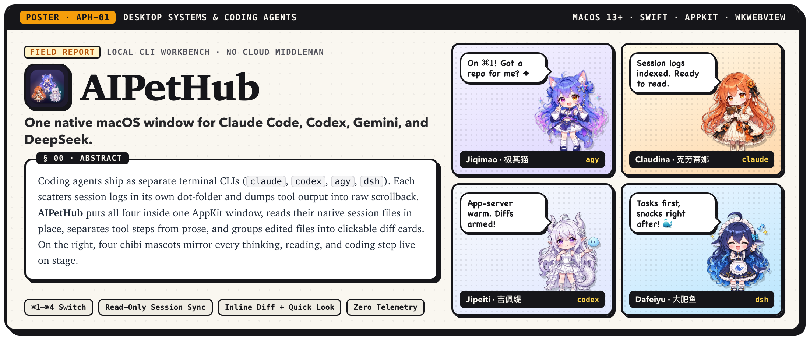
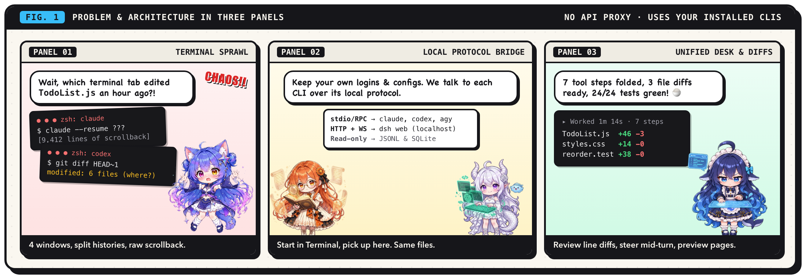
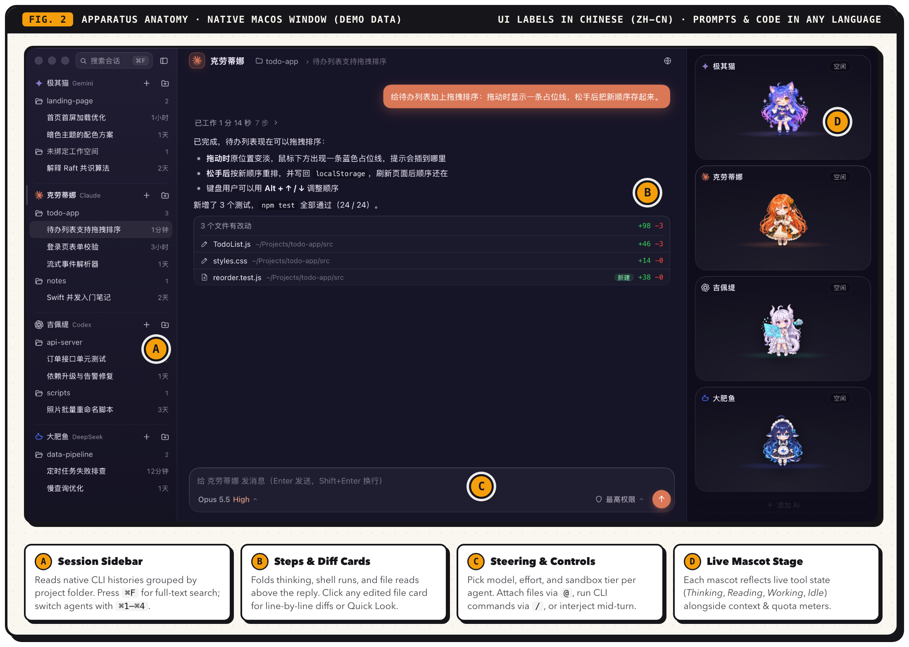
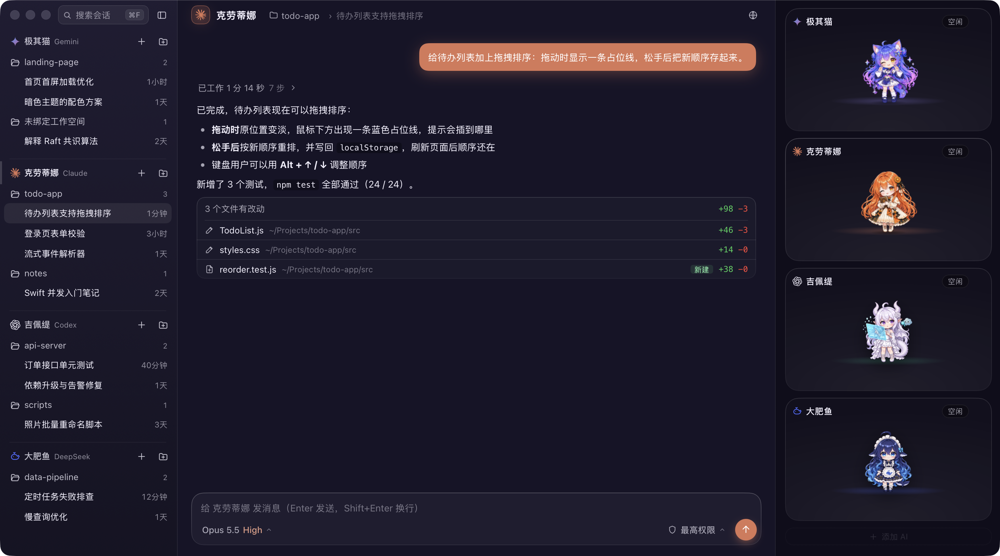
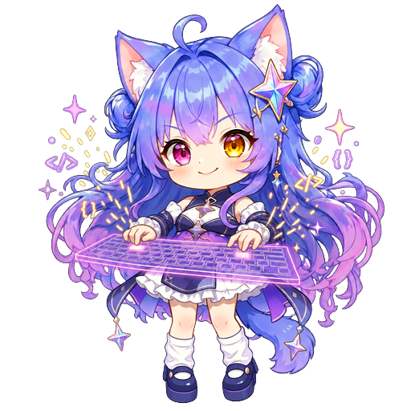

<a id="top"></a>

<p align="center">
  
</p>

<p align="center">
  <b>Four local coding-agent CLIs &middot; One native macOS workbench &middot; Live chibi stage &middot; Zero cloud middleman</b><br>
  <sub>Run <code>claude</code>, <code>codex</code>, <code>agy</code>, and <code>dsh</code> side by side &mdash; sharing your existing Terminal logins, session files, MCP servers, and skills.</sub>
</p>

<p align="center">
  <a href="../../releases/latest"></a>
  
  
  <a href="LICENSE"></a>
  <a href="ASSETS-LICENSE.md"></a>
</p>

<p align="center">
  <sub>
    <a href="#s01"><b>§ 01</b> Architecture</a> &nbsp;&middot;&nbsp;
    <a href="#s02"><b>§ 02</b> Capabilities</a> &nbsp;&middot;&nbsp;
    <a href="#s03"><b>§ 03</b> Supported CLIs</a> &nbsp;&middot;&nbsp;
    <a href="#s04"><b>§ 04</b> Mascot Stage</a> &nbsp;&middot;&nbsp;
    <a href="#s05"><b>§ 05</b> Installation</a> &nbsp;&middot;&nbsp;
    <a href="#s06"><b>§ 06</b> Safety &amp; Privacy</a> &nbsp;&middot;&nbsp;
    <a href="#s07"><b>§ 07</b> Controls &amp; Build</a> &nbsp;&middot;&nbsp;
    <a href="#s08"><b>§ 08</b> License</a> &nbsp;&middot;&nbsp;
    <a href="docs/ARCHITECTURE.md">Architecture Notes (ZH) &#8599;</a>
  </sub>
</p>

---

<a id="s01"></a>

## `§ 01` &middot; Motivation & Local-First Architecture

<p align="center">
  
  <br>
  <sub><b>Fig. 1.</b> Terminal sprawl vs. AIPetHub's local protocol bridge &mdash; zero cloud middleman, shared session files, and turn-scoped file diffs.</sub>
</p>

Coding agents today ship primarily as standalone terminal tools: **Claude Code** (`claude`), **Codex** (`codex`), **Antigravity / Gemini** (`agy`), and **DeepSeek Harness** (`dsh`). Running all four side by side means juggling terminal tabs, hunting down conversation logs across separate dot-folders, skimming thousands of lines of raw scrollback, and running `git diff` by hand to figure out which agent touched what.

**AIPetHub** puts those local CLIs inside one native macOS window without sitting between you and their servers:

<table>
  <tbody>
    <tr>
      <td width="50%" valign="top">
        <b><code>01</code> &middot; One Desk, Four Agents</b><br>
        <sub>Switch active slots instantly with <kbd>&#8984;1</kbd>&ndash;<kbd>&#8984;4</kbd>, run multiple threads per agent in parallel, or hand the exact same problem to two agents side by side and compare how they solve it.</sub>
      </td>
      <td width="50%" valign="top">
        <b><code>02</code> &middot; Shared History &amp; Live Terminal Sync</b><br>
        <sub>Reads each CLI's native store directly in place (<code>JSONL</code> and <code>SQLite</code>, opened read-only) grouped by workspace folder. Start a thread in <code>zsh</code>, continue it here &mdash; and if it is still running in Terminal, watch it stream live with an elapsed timer.</sub>
      </td>
    </tr>
    <tr>
      <td width="50%" valign="top">
        <b><code>03</code> &middot; Readable Turns &amp; Exact Turn Diffs</b><br>
        <sub>Separates reasoning, shell commands, and file reads from the final prose answer. <b>Changes this turn</b> snapshots content before and after each reply so summary cards count <i>only</i> what the agent changed in that turn, ignoring pre-existing uncommitted edits.</sub>
      </td>
      <td width="50%" valign="top">
        <b><code>04</code> &middot; Bring Your Own CLI (Zero Proxy)</b><br>
        <sub>AIPetHub makes no model API calls and stores no credentials. It spawns the CLI binaries already installed and signed in on your Mac, inheriting your configs, MCP servers, hooks, and skills.</sub>
      </td>
    </tr>
  </tbody>
</table>

<details>
<summary><sub><b>Under the Hood &middot; Local Process Protocols, Prewarming &amp; Snapshot Diffing</b></sub></summary>

<br>

| Agent | Bidirectional Local Transport (Fallback) | Default Permission Flag | Native Session Store (Read-Only) |
|---|---|---|---|
| **Claude Code** | `claude -p --input-format stream-json --output-format stream-json --permission-prompt-tool stdio` (`claude -p`) | `--permission-mode bypassPermissions` | `~/.claude/projects/*/<id>.jsonl` |
| **Codex** | `codex app-server` JSON-RPC (`codex exec --json`) | `-c sandbox_mode="danger-full-access"` | `$CODEX_HOME` (or `~/.codex`) `state_5.sqlite`, `thread_history_1.sqlite` & `sessions/**/rollout-*.jsonl[.zst]` |
| **Gemini** | `agy acp` Agent Client Protocol (`agy -p … --output-format stream-json`) | `--dangerously-skip-permissions` | `conversations/<id>.db` (`steps` protobuf table, with transcript fallback) |
| **DeepSeek** | Shared localhost `dsh web` service (`POST /api/<method>` + dual WebSockets) | `danger-full-access` preset | Local `dsh` `session.list` & `session.history` endpoints |

- **Process Prewarming:** As you begin typing or right after a turn finishes, AIPetHub warms a background process matching your active session, model, permission tier, and workspace so the next prompt dispatches without cold-start lag. After a reply, Codex and Gemini warm the CLI connection. Claude prewarms new conversations only. For existing conversations, Claude and Codex resume when you send. Gemini resumes as you type, releases the session after 90 seconds of inactivity, and resumes again if its history changed before you send. Other unused prewarmed processes expire after 10 minutes.
- **Non-Invasive Git Content Snapshots:** To capture files modified by shell commands as well as edit tools, AIPetHub snapshots workspace contents before and after each turn using an isolated temporary Git index and object directory — never touching your real `.git/index`, `HEAD`, or `stash` (compatible with Git LFS filters).

</details>

---

<a id="s02"></a>

## `§ 02` &middot; Apparatus & Workbench Capabilities

<p align="center">
  
  <br>
  <sub><b>Fig. 2.</b> Annotated workbench anatomy &mdash; <b>(A)</b> workspace-grouped session sidebar, <b>(B)</b> folded tool steps &amp; turn-scoped diff cards, <b>(C)</b> per-agent steering &amp; permission controls, and <b>(D)</b> live reactive mascot stage.</sub>
</p>

<details>
<summary><sub><b>Inspect unannotated 2&times; macOS window capture</b></sub></summary>

<br>

<p align="center">
  
</p>

</details>

<p align="center"><sub><b>Table I.</b> Core Workbench Capabilities</sub></p>

| Subsystem | Behavior |
|---|---|
| **Multi-Agent Roster** | Run up to four CLIs side by side (<kbd>⌘1</kbd>–<kbd>⌘4</kbd>). Enable or remove any slot at will; adding an agent probes your login-shell `PATH` (including `nvm` and `volta`) and runs a one-line handshake check. |
| **Visible-Text Search (<kbd>⌘F</kbd>)** | Searches the rendered text you actually see inside a conversation — prompts, replies, mid-turn follow-ups, and tool step titles/outputs — across **all four agents**, including DeepSeek and archived/compressed (`.jsonl.zst`) Codex sessions. Results stream in progressively as matches are found; extracted text is cached on disk (`~/Library/Caches/AIPetHub`), so even the first search after a relaunch finishes in well under a second. |
| **Session Browser & Live Sync** | Groups conversations by workspace, including Codex threads stored only as compressed rollouts. Chats that Codex Desktop marks as projectless appear under **Unbound workspace** and resume in their original directory. Multiple threads can run per agent, and older history loads on demand. Codex and DeepSeek keep the **running elsewhere** timer visible during silent reasoning and clear it when the turn ends. |
| **Step Folding** | Streams reasoning blocks, shell commands + stdout, and file operations step by step while running, then folds finished work into a compact `"Worked N s · M steps"` summary header above the reply. |
| **Mid-Turn Steering & Images** | Queue a follow-up, cut in immediately, abort the entire process tree, or approve/deny tool prompts while an answer is still streaming. Images attached to a mid-answer follow-up ("你补充说" / steer) display inline as thumbnails and click open full-size — both live and when reloading history in Claude and Codex. Gemini shows them live too; after a reload its follow-up appears as a separate prompt with the same images. |
| **Turn-Scoped Diffs & Preview** | **Changes this turn** (`本轮改动`) counts *only* what the agent created, edited, or deleted during that turn — never uncommitted edits you already had open beforehand. Click any file for full-file line diffs, Markdown, images, PDFs, or offline Office previews (`docx` / `xlsx` / `pptx` rendered via macOS Quick Look). |
| **Built-In Local Browser** | Preview `localhost` dev servers directly inside the split pane. Agents can also drive this browser to open pages, capture screenshots, and read console errors to verify their own UI work. |
| **Model & Quota Sync** | Pulls model lists and reasoning-effort tiers straight from each CLI. Displays live context-window occupancy, restores recorded usage when opening a conversation, and shows remaining quota (or account balance for DeepSeek) on the stage. |
| **Native AppKit Window** | Dark frosted-glass macOS chrome (`Swift` + `AppKit` + `WKWebView`). Bounces and badges the Dock icon when a background turn finishes or awaits approval instead of firing system notification banners. |

---

<a id="s03"></a>

## `§ 03` &middot; Subject Profiles (Supported CLIs)

Install **at least one** CLI below and complete its sign-in once in Terminal. Missing CLIs stay disabled cleanly without affecting the others.

<p align="center"><sub><b>Table II.</b> Field Cast &amp; Local CLI Bindings</sub></p>

<table>
  <thead>
    <tr>
      <th width="25%" align="center">Claudina &middot; 克劳蒂娜<br><sub>Claude Code</sub></th>
      <th width="25%" align="center">Jipeiti &middot; 吉佩缇<br><sub>Codex</sub></th>
      <th width="25%" align="center">Jiqimao &middot; 极其猫<br><sub>Gemini</sub></th>
      <th width="25%" align="center">Dafeiyu &middot; 大肥鱼<br><sub>DeepSeek</sub></th>
    </tr>
  </thead>
  <tbody>
    <tr>
      <td align="center">
        <br>
        <sub><i>"Tome open. Writing patches."</i></sub>
      </td>
      <td align="center">
        <br>
        <sub><i>"Patching in parallel."</i></sub>
      </td>
      <td align="center">
        <br>
        <sub><i>"Mapping the repo stars..."</i></sub>
      </td>
      <td align="center">
        <br>
        <sub><i>"Will optimize SQL for lunch."</i></sub>
      </td>
    </tr>
    <tr>
      <td valign="top">
        <b>CLI:</b> <code>claude</code><br>
        <b>Channel:</b> <code>stream-json</code> stdio
      </td>
      <td valign="top">
        <b>CLI:</b> <code>codex</code><br>
        <b>Channel:</b> <code>app-server</code> JSON-RPC
      </td>
      <td valign="top">
        <b>CLI:</b> <code>agy</code><br>
        <b>Channel:</b> <code>agy acp</code> protocol
      </td>
      <td valign="top">
        <b>CLI:</b> <code>dsh</code><br>
        <b>Channel:</b> Local <code>dsh web</code> HTTP + WS
      </td>
    </tr>
    <tr>
      <td valign="top">
        <b>Setup</b><br>
        <code>npm i -g @anthropic-ai/claude-code</code><br>
        <sub>Then run <code>claude</code> in Terminal to log in.</sub>
      </td>
      <td valign="top">
        <b>Setup</b><br>
        <code>npm i -g @openai/codex</code><br>
        <sub>Run <code>codex login</code> (or reuse the binary inside <code>ChatGPT.app</code>).</sub>
      </td>
      <td valign="top">
        <b>Setup</b><br>
        Install <a href="https://antigravity.google/"><b>Antigravity</b></a><br>
        <sub>Then run <code>agy</code> in Terminal to sign in.</sub>
      </td>
      <td valign="top">
        <b>Setup</b><br>
        <code>npm i -g @deepseek-ai/dsh</code><br>
        <sub>Then set your API key per <code>dsh</code> docs.</sub>
      </td>
    </tr>
  </tbody>
</table>

---

<a id="s04"></a>

## `§ 04` &middot; Mascot Behavioral States

Each mascot on the right-hand stage reacts in real time to the live event stream emitted by its CLI process — combining layered skeletal rigs (*Jiqimao*, *Claudina*, *Jipeiti*) and frame-by-frame animation (*Dafeiyu*):

<table>
  <tbody>
    <tr>
      <td align="center" width="16%">
        <br>
        <b>Idle</b><br><sub>Blinks, strolls, chats when clicked</sub>
      </td>
      <td align="center" width="16%">
        <br>
        <b>Thinking</b><br><sub>Reasoning blocks streaming</sub>
      </td>
      <td align="center" width="16%">
        <br>
        <b>Reading</b><br><sub>File reads, grep, web lookups</sub>
      </td>
      <td align="center" width="16%">
        <br>
        <b>Working</b><br><sub>Edits, writes, shell commands</sub>
      </td>
      <td align="center" width="16%">
        <br>
        <b>Done</b><br><sub>Turn complete; Dock bounces</sub>
      </td>
      <td align="center" width="16%">
        <br>
        <b>Sleeping</b><br><sub>Naps after configurable idle timer</sub>
      </td>
    </tr>
  </tbody>
</table>

<p align="center">
  <sub><b>Fig. 3.</b> Real-time stage state transitions &mdash; mascots can also be dragged on stage, toggled between roaming and resting, and woken automatically as soon as you start typing.</sub>
</p>

---

<a id="s05"></a>

## `§ 05` &middot; Deployment Protocol (Installation)

**Requirements:** **macOS 13 Ventura** or later, plus at least one CLI from [`§ 03`](#s03) installed and authenticated.

1. **Install the App:** Download `AIPetHub-<version>.dmg` from [**Releases**](../../releases/latest), open the disk image, and drag **AIPetHub** into `/Applications`.
2. **Clear Gatekeeper Once:** Because builds use ad-hoc signing rather than Apple notarization, macOS Gatekeeper blocks the very first launch. Clear it once using any of these three methods:
   - **Terminal (one-liner):**
     ```bash
     xattr -dr com.apple.quarantine /Applications/AIPetHub.app
     ```
   - **Finder:** Right-click `AIPetHub.app` in `/Applications` &rarr; **Open** &rarr; **Open**.
   - **System Settings:** Open **Privacy & Security**, scroll down to the blocked-app notice, and click **Open Anyway**.
3. **First-Launch Onboarding:** An onboarding screen detects which CLIs are installed on your Mac, shows setup hints for any missing ones, and lets you choose your default permission posture before starting.

---

<a id="s06"></a>

## `§ 06` &middot; Permissions, Safety & Privacy

> [!WARNING]
> **Full permissions are enabled by default.** Unless changed, agents launch in their most-permissive mode (`bypassPermissions` / `danger-full-access` / `--dangerously-skip-permissions`) so they can edit files and execute shell commands without pausing to ask at every step. If an agent misjudges a command, it will not stop first.

<table>
  <tbody>
    <tr>
      <td width="136" align="center" valign="middle">
        <br>
        <sub><i>"Read this before handing us root."</i></sub>
      </td>
      <td valign="middle">
        <b>Dialing Permissions Back</b><br><br>
        &bull; <b>First-launch toggle:</b> Switch the global default to <b>Conservative</b> with a single click on the onboarding screen (prompts before shell execution or restricts writes to the current workspace, depending on the CLI).<br>
        &bull; <b>Per-agent shield menu:</b> Change permission tiers for any individual agent anytime from the shield menu at the bottom-right of the composer.<br>
        &bull; <b>Best practice:</b> Keep full permissions strictly inside repositories you trust and track under Git.
      </td>
    </tr>
  </tbody>
</table>

<p align="center"><sub><b>Table III.</b> Local-Only Privacy Guarantees</sub></p>

| Guarantee | Details |
|---|---|
| **Zero Telemetry** | AIPetHub collects no analytics and runs no backend servers. All model traffic stays inside each CLI's own local process. |
| **In-Place Sessions** | Conversation logs remain in each CLI's native directory (`~/.claude`, `~/.codex`, Antigravity CLI and desktop `conversations/*.db`, `dsh`'s local store) and are opened read-only. While Antigravity desktop is running, its conversations are read-only in AIPetHub. Quit the desktop app to resume them in place through ACP or delete them. New Gemini conversations are created in the CLI directory as usual. Codex history follows `CODEX_HOME` when passed to AIPetHub. DeepSeek session files and attachments follow `DSH_HOME` (default `~/.dsh`). |
| **No Stored Keys** | AIPetHub saves no tokens or passwords. The single key it reads is DeepSeek's API key from `dsh`'s config: because `dsh` exposes no balance endpoint, AIPetHub uses that key once every **5 minutes** to query `api.deepseek.com/user/balance` directly — never saving or forwarding it anywhere else. Remove *Dafeiyu* from the stage if you do not want balance polling. |

---

<a id="s07"></a>

## `§ 07` &middot; Controls, Source Build & Field Notes

### Keyboard & Composer Shortcuts

<p align="center"><sub><b>Table IV.</b> Day-to-Day Navigation &amp; Composer Bindings</sub></p>

| Action | Shortcut / Gesture |
|---|---|
| Switch active agent | <kbd>⌘1</kbd> – <kbd>⌘4</kbd>, or click the agent header in the left sidebar |
| New session | <kbd>⌘N</kbd>, or click the folder-plus icon next to an agent header to pick a project directory |
| Full-text history search | <kbd>⌘F</kbd> (reopens the sidebar if hidden and streams visible-text matches across all agents) |
| Send / insert newline | <kbd>Enter</kbd> to send &middot; <kbd>Shift</kbd>+<kbd>Enter</kbd> for a newline |
| Browse sent prompts | <kbd>↑</kbd> / <kbd>↓</kbd> when the input box is empty |
| Attach files or images | Drag files into the window, copy them in Finder and paste with <kbd>⌘</kbd><kbd>V</kbd>, or click 📎; paste screenshots from the clipboard; type <kbd>@</kbd> to fuzzy-find workspace files. Images go to the model as images, other files (zip, PDF, code…) are passed by path for the CLI to read |
| Run CLI slash commands | Type <kbd>/</kbd> in the input box |
| Add / remove agents | Gear icon on any mascot card &rarr; **Remove** &middot; `+` button at the bottom of the stage to add |
| Adjust UI font size | <kbd>⌘+</kbd> / <kbd>⌘-</kbd> / <kbd>⌘0</kbd> |
| Close viewer or popover | <kbd>Esc</kbd> (closes full-size image viewer, open popovers, or maximized preview pane) |

### Build from Source

Requires only **Xcode Command Line Tools** (`xcode-select --install`). Zero external Swift package dependencies.

```bash
git clone https://github.com/YaowenHu2000/AIPetHub-public.git
cd AIPetHub-public/ai-pet-hub

./build.sh              # Compile into build/AIPetHub.app
./build.sh --install    # Copy to /Applications and launch
tools/make-dmg.sh 1.0.0 # Build distributable build/AIPetHub-1.0.0.dmg
tools/test.sh           # Run offline Swift, Markdown, and UI logic tests (no CLI or network needed)
tools/uitest/all.sh     # Run the window suites after ./build.sh (Claude, Codex, Gemini + DeepSeek; real CLI quota)
tools/uitest/clean.sh   # Remove test sessions
```

> [!TIP]
> If `cwebp` (`brew install webp`) is installed, packaging automatically converts PNG sprite frames into WebP and shrinks the app bundle substantially. Internal process protocols, prewarming, snapshot diffing, and end-to-end test harnesses are documented in [docs/ARCHITECTURE.md](docs/ARCHITECTURE.md) (in Chinese).

### Known Quirks & Limitations

- **App UI language:** Built-in interface labels and menus are currently in Simplified Chinese (`zh-CN`). Prompts, code, file paths, search queries, and agent replies work in any language.
- **Gemini mid-turn messages:** Follow-ups typed while Gemini is answering go straight into the running turn. While Gemini is waiting for a tool approval or for your answer to its question, `agy acp` refuses them; they stay in the queue and send automatically once the active turn finishes. After reloading history, a Gemini follow-up shows as a separate prompt (with its images) rather than as a "你补充说" step.
- **Simultaneous two-way edits in Terminal + AIPetHub:** Watching an externally active session inside AIPetHub works seamlessly (**running elsewhere** live sync). When another Claude client already holds the session, sending from AIPetHub opens a fork. If a terminal joins after AIPetHub starts answering, expand the concurrent conversation step to read the other branch. Future Claude turns follow the main branch. Gemini asks you to close the other client before sending. Codex clients see each other's persisted turns when they reload.
- **DeepSeek (`dsh` preview):** Integration targets the local HTTP/WebSocket API of `dsh` preview (`0.1.0-rc.7`) and may need updates as `dsh` evolves. Long histories load earlier batches on demand, and full-text search (<kbd>⌘F</kbd>) reads DeepSeek through its local service (reporting explicitly when any source cannot be searched). Changing DeepSeek's model or reasoning effort inside AIPetHub also updates `dsh`'s default in `~/.dsh/settings.yaml`.

---

<a id="s08"></a>

## `§ 08` &middot; License & Colophon

<p align="center"><sub><b>Table V.</b> Repository License Split</sub></p>

| Scope | License | Terms |
|---|---|---|
| **Source Code** | [**GPL-3.0**](LICENSE) | Covers all Swift sources (`Sources/`), frontend HTML/CSS/JS, build/test scripts, and skeletal rig runtime & data scripts (`web/rig/*.js`). |
| **Character Artwork & Visual Assets** | [**CC BY-NC-SA 4.0**](ASSETS-LICENSE.md) | Covers sprites (`web/sprites/`), layered rig textures (`web/rig/`), `AppIcon.icns`, and poster illustrations (`docs/images/`). You may share and adapt the art for **non-commercial** use under the same license with attribution to `AIPetHub (https://github.com/YaowenHu2000)`. |

> [!NOTE]
> **Fan-Character Disclaimer & Credits:** *Jiqimao* (极其猫), *Claudina* (克劳蒂娜), *Jipeiti* (吉佩缇), and *Dafeiyu* (大肥鱼) are unofficial fan-made mascot designs and have **no affiliation** with Google, Anthropic, OpenAI, or DeepSeek. Product names and logos belong to their respective owners.
>
> *Dafeiyu* draws inspiration from the Chinese community's co-created DeepSeek whale-girl design, particularly `@iamemily2050`'s character sheet; all sprites were newly generated and hand-processed for this project (details in [ASSETS-LICENSE.md](ASSETS-LICENSE.md)).

<p align="center">
  <sub>
    <b>Bundled Open-Source Libraries:</b>&nbsp;
    <a href="https://highlightjs.org/">highlight.js</a> (BSD-3-Clause) &middot;
    <a href="https://katex.org/">KaTeX</a> (MIT) &middot;
    <a href="https://threejs.org/">three.js</a> (MIT)
  </sub>
</p>

<br>

<p align="center">
  <br>
  <sub><code>[ POSTER APH-01 &middot; ALL PROCESSES IDLE &middot; zZZ ]</code></sub><br>
  <sub><a href="#top">&uarr; Back to Top</a></sub>
</p>
