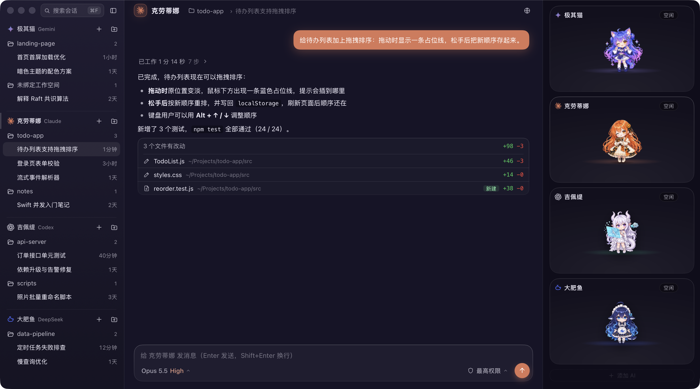

<p align="center">
  
</p>

<h1 align="center">AIPetHub</h1>

<p align="center">
  <b>一个原生 macOS 窗口，同时用好 Claude Code、Codex、Gemini 和 DeepSeek 四个编程智能体。</b><br>
  <a href="README.md">English Poster Edition</a> · <b>简体中文</b>
</p>

<p align="center">
  <a href="../../releases/latest"></a>
  
  
  <a href="LICENSE"></a>
</p>



## 它是什么

现在的编程智能体大多以**命令行工具（CLI）**的形式出现：Claude Code、Codex、Antigravity（Gemini）、DeepSeek Harness……每个都要开一个终端窗口，会话散落在各自的目录里，回答是滚动的纯文本，改了哪些文件要自己去翻。

AIPetHub 把这些 CLI **集成到同一个窗口**里：

- **统一入口**：四个智能体并排，⌘1–⌘4 切换；同一个问题可以分别交给不同的智能体。
- **统一会话**：直接读取各 CLI 自己的会话记录，按项目分组；在终端里聊过的会话也能在这里接着聊。
- **看得懂的回答**：工作过程（思考、命令、读写文件）和正文分开呈现，改动的文件汇总成卡片，点开就是带差异标注的预览。
- **不替代 CLI**：AIPetHub 本身不调用模型、不保存凭据，所有请求都交给你本机已经装好、登录好的 CLI，沿用它们自己的配置。

每个智能体配有一个 Q 版角色——极其猫（Gemini）、克劳蒂娜（Claude）、吉佩缇（Codex）、大肥鱼（DeepSeek）——在右侧实时反映它在思考、查资料还是改代码。

## 功能

| | |
|---|---|
| **多智能体** | 四个 CLI 并排使用；用哪几个可以随时增删，添加前会自动查找本机的命令并发一句话验证 |
| **会话管理** | 按项目分组、全文搜索（⌘F）、同一智能体同时跑多个会话；会话在别处运行时自动同步新内容 |
| **实时过程** | 回答边生成边显示；思考、命令与输出、文件读写按步骤展开，完成后折叠为「已工作 N 秒 · M 步」 |
| **中途介入** | 回答进行中可以补充一句、插队、停止，或者审批它要做的操作 |
| **改动审阅** | 改动文件汇总成卡片；预览面板在完整文件上逐行标注增删，Markdown、图片、PDF、Office 文档都能直接看 |
| **内置浏览器** | 预览本地网页；智能体也能用它打开页面、截图、读控制台，自己检查做出来的网页 |
| **模型与用量** | 模型和思考强度跟着 CLI 自动同步；面板里能看到上下文占用和剩余额度（DeepSeek 显示账户余额） |
| **原生体验** | Swift + AppKit 窗口，深色毛玻璃界面；回答完成或需要你决定时 Dock 图标提醒，不弹系统通知 |

## 支持的智能体

| 角色 | 智能体 | 需要安装的 CLI | 安装 |
|---|---|---|---|
| 克劳蒂娜 | Claude | Claude Code（`claude`） | `npm install -g @anthropic-ai/claude-code`，然后运行 `claude` 登录 |
| 吉佩缇 | Codex | Codex CLI（`codex`） | `npm install -g @openai/codex`，然后运行 `codex login`；装了 ChatGPT 桌面版也能直接用它自带的 |
| 极其猫 | Gemini | Antigravity CLI（`agy`） | 安装 [Antigravity](https://antigravity.google/)，然后运行 `agy` 登录 |
| 大肥鱼 | DeepSeek | DeepSeek Harness（`dsh`） | `npm install -g @deepseek-ai/dsh`，按它的说明配置 API 密钥 |

装一个就能用，没装的不影响其他几个。AIPetHub 会在常见位置和登录 shell 的 `PATH` 里查找这些命令（nvm、volta 安装的也找得到）。

## 安装

1. 到 [Releases](../../releases/latest) 下载 `AIPetHub-<版本>.dmg`，打开后把 AIPetHub 拖进「应用程序」。
2. 第一次打开时，系统会提示「无法验证开发者」（安装包没有经过苹果公证）。放行一次即可：
   - 在「应用程序」里**右键** AIPetHub →「打开」→ 再点「打开」；
   - 或者：「系统设置 › 隐私与安全性」→ 找到 AIPetHub →「仍要打开」；
   - 或者在终端运行：`xattr -dr com.apple.quarantine /Applications/AIPetHub.app`
3. 打开后有一页引导：列出本机找到了哪些智能体、缺的怎么装，并让你选择默认权限。

**系统要求**：macOS 13 Ventura 或更高版本，至少装好并登录一个上面的 CLI。

## 权限与安全

> [!WARNING]
> **默认使用最高权限**：智能体可以不经询问地执行命令、读写本机任何文件。这样用起来最顺手，但它做错了事不会先停下来问你。

- 第一次打开的引导页可以一键改成「保守」：改文件、跑命令前先问你，或者只允许修改当前工作空间（各 CLI 的档位不同）。
- 之后随时可以在输入框右下角为每个智能体单独切换。
- 建议只在你信任的项目里使用最高权限。

## 隐私

- AIPetHub 没有遥测，不收集任何数据；网络访问都由各 CLI 自己完成。
- 会话保留在各 CLI 原来的位置，AIPetHub 只读取、不复制。
- 不保存任何凭据。唯一读取的是 DeepSeek 的 API 密钥：dsh 没有查余额的接口，AIPetHub 用 dsh 配置的那把密钥每 5 分钟查一次账户余额（`api.deepseek.com/user/balance`），不另存、不发往别处。不需要的话把大肥鱼移除即可。

## 常用操作

| 操作 | 方式 |
|---|---|
| 切换智能体 | ⌘1 ～ ⌘4，或点侧边栏的区域标题 |
| 新建会话 | ⌘N；在某个项目里新建：区域标题右边的文件夹按钮 |
| 增删智能体 | 角色卡片右上角齿轮 →「移除」；舞台最下面「添加 AI」 |
| 引用文件 / 截图 | 把文件拖进窗口，或在输入框里粘贴截图；输入 `@` 查找文件，`/` 列出 CLI 的命令 |
| 搜索会话 | ⌘F |
| 调整字号 | ⌘+ / ⌘- / ⌘0 |

## 从源码构建

需要 Xcode Command Line Tools（`xcode-select --install`），没有第三方依赖。

```bash
git clone https://github.com/YaowenHu2000/AIPetHub-public.git
cd AIPetHub-public/ai-pet-hub
./build.sh              # 构建到 build/AIPetHub.app
./build.sh --install    # 安装到 /Applications 并启动
tools/make-dmg.sh 1.0.0 # 打包安装包 build/AIPetHub-1.0.0.dmg
tools/test.sh           # 离线测试（不需要 CLI 和网络）
```

装了 `cwebp`（`brew install webp`）时，打包会把角色素材转成 WebP，App 体积小很多。架构、目录结构和测试方法见 [docs/ARCHITECTURE.md](docs/ARCHITECTURE.md)。

## 已知限制

- Gemini 回答进行中不能插话（协议限制），补充的话会排队，这一轮结束后自动发出。
- 在终端和 AIPetHub 里**同时**开着同一个会话时：Claude 会自动另开一个分支会话；Codex、Gemini 两边互相看不到对方的新内容。
- DeepSeek 的接入基于 dsh 预览版的本机接口，dsh 升级后可能需要更新；暂不支持搜索 DeepSeek 会话的正文。
- 在 AIPetHub 里给 DeepSeek 选的模型和思考强度，dsh 会记成它自己的默认值。

## 许可证

- **代码**：[GPL-3.0](LICENSE)
- **角色美术**（角色图片、应用图标、截图）：[CC BY-NC-SA 4.0](ASSETS-LICENSE.md)——可以转载和改编，需署名、不可商用、改编后以相同许可发布。
- 四位角色均为非官方同人形象，与 Anthropic、OpenAI、Google、DeepSeek 无关；各公司的名称和标志归其所有者。大肥鱼的形象参考了社区共创的 DeepSeek 鲸鱼娘，尤其是 @iamemily2050 的设定图，详见 [ASSETS-LICENSE.md](ASSETS-LICENSE.md)。

## 致谢

[highlight.js](https://highlightjs.org/)（BSD-3-Clause）· [KaTeX](https://katex.org/)（MIT）· [three.js](https://threejs.org/)（MIT）
