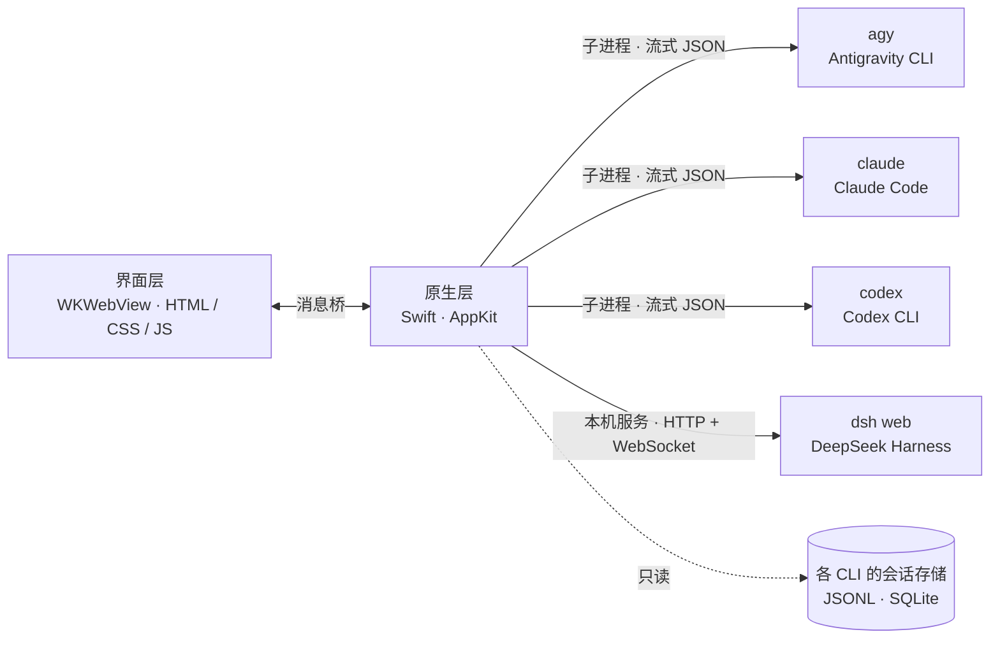

# 架构与开发

这份文档写给想读代码、改代码的人。使用说明见 [README](../README.md)。

## 工作原理



- 每次提问用一个对应的 CLI 进程，用它的双向协议对话（标准输入开着）：`claude -p --input-format stream-json`、`codex app-server`（JSON-RPC）、`agy acp`（Agent Client Protocol）。中途补充、停止、它提的问题、审批都走这条通道，这一轮答完就关掉输入让进程退出；CLI 版本太旧不支持时自动退回一问一答（`claude -p`、`codex exec`、`agy -p`）。事件流统一转换为「工作步骤 + 正文 + 改动文件」后推送到界面。
- 用户开始打字或上一轮答完时，App 按会话、模型、权限和工作空间预热。Codex 和 Gemini 答完后只握手，开始打字才提前续接已有会话，停打 90 秒释放。发送前核对续接成功时的记录指纹，变化就重新续接；Gemini 还会核对外部持库进程。新会话仍在发送时创建。Codex 在握手后查询模型。每位最多保留一个预热进程，其余预热 10 分钟过期。Claude 预热后若记录在别处更新，发送时重新启动。
- Codex / Gemini 的交互式初始化每个有效阶段最多静默等待 300 秒，推进后重新计时，重复消息不续期；仅在提问尚未排入输入时超时回退一问一答。提问或压缩命令一旦排队，就永久取消这轮初始化期限，慢回答不会被重发。Claude 立即排入提问，不走这项回退期限；其参数能力按可执行文件指纹缓存，包装器每次探测，CLI 升级后会刷新。
- 继续历史会话时使用各 CLI 自带的恢复方式（`--resume`、`thread/resume`、`session/resume`），会话始终保存在 CLI 原有的位置。Gemini 合并 agy CLI 和 Antigravity 桌面版的历史。桌面会话在 App 内用 `desktop:<id>` 区分来源，交给 `agy acp --app-data-dir antigravity` 时使用原始 ID。单次模式不支持选择桌面目录，桌面续接失败时保留原会话并提示。桌面版运行期间（含无法确认进程状态时），桌面会话可查看和搜索，发送、打字预热续接和删除均被拦住，避免内存缓存写回覆盖更改。新会话沿用 CLI 目录。发送前检查目标库是否由外部 agy 或 Antigravity 的 language_server 持有。Codex 的已索引线程通过同一个 app-server 批量调用 `thread/archive`，只有无索引的旧 rollout 才直接挪入归档目录。
- 打开模型菜单先显示缓存，再按需通过后台用量查询获取当前 CLI 的列表。Claude、Codex、Gemini 按位去重，预热和后台查询收到的模型也会更新已打开的菜单。
- 打开历史时附上最近一次有记录的上下文用量。Claude 复用主线回答，按模型估算窗口；Codex 从 rollout 末尾找用量，已有完整压缩投影时先显示正文，再在后台解压补数；Gemini 在对应来源的会话库读生成记录；DeepSeek 复用历史尾页的投影。网页按用量事件的时间或序号比较，新一轮的历史估算不沿用上一轮的明细。
- 历史列表直接读取 CLI 自身的存储（Claude Code 的 JSONL、Codex 与 Antigravity 的 SQLite），以只读方式打开。正文搜索先筛候选，再复用打开会话的历史解析和网页 Markdown 渲染确认；覆盖用户消息、回答、补充以及工作步骤的标题、详情和输出。结果分批累计返回，来源读不到时明确提示。可见文字先查内存（上限 96 MiB），再查 `~/Library/Caches/AIPetHub/ConversationSearch`（上限 256 MiB，按最久未使用淘汰）；后台合并并原子写入，搜索不等待写盘。两层均核对来源的修改时间、大小（含 SQLite WAL）和引用文件、图片依赖；共享 Codex 数据库变化时，再用本会话原始字段的 SHA256 摘要复核，避免无关写入导致重算。磁盘缓存另校验格式版本、渲染规则版本和内容摘要，损坏或版本不符时静默丢弃重算。改变可见文字规则时须递增 `ConversationSearchText.version`，改变缓存格式时递增 `ConversationSearchDiskCache.formatVersion`；自测始终使用临时缓存目录。
- 历史默认只显示最近 300 条；点「显示更早」或定位搜索命中时按需增加显示范围，不再在 5000 条处截断。网页按请求编号区分打开历史、后台同步和补充后的回读。同一页面开始或结束新一轮时，旧的后台回包不再改动刚画出的节点。
- 文档预览用 macOS 自带的 Quick Look（`qlmanage -p -o`，和访达里按空格看到的一样）把 Office 文件转成网页，RTF / ODT 用系统文本引擎转，再放进内置浏览器显示；转出来的网页加了禁止联网的内容安全策略，缓存在 `~/Library/Caches/AIPetHub/DocPreview`（按路径、修改时间和大小区分，最多保留 12 份、3 天）。

**实现要点**

| | 调用方式 | 默认权限（最高） | 历史会话来源 |
|---|---|---|---|
| Gemini | `agy acp`（退回：`agy -p … --output-format stream-json`） | `--dangerously-skip-permissions`；可选 `--mode accept-edits / plan` | 每个会话自己的 `conversations/<id>.db`（`steps` 表，protobuf），读不到时退回全文索引和 transcript |
| Claude | `claude -p --input-format stream-json --output-format stream-json --permission-prompt-tool stdio`（退回：不带后两个参数） | `--permission-mode bypassPermissions` | `~/.claude/projects/*/<id>.jsonl` |
| Codex | `codex app-server`（退回：`codex exec --json`） | `-c sandbox_mode="danger-full-access"` | `CODEX_HOME`（未设置时为 `~/.codex`）下的 `state_5.sqlite`、`thread_history_1.sqlite` 与 `sessions/**/rollout-*.jsonl[.zst]` |
| DeepSeek | 常驻一个只听本机的 `dsh web` 服务（所有会话共用），`POST /api/<方法>` 发、两条 WebSocket 收事件 | 权限预设 `danger-full-access` | 通过服务的 `session.list` / `session.history` 读 |

DeepSeek 历史按每批最多 60 页读取，保留服务端游标和「还有更早内容」状态；点击「显示更早」从旧游标继续，后台同步合并新记录，搜索定位需要更早内容时继续取足请求范围。Codex rollout 的新旧事件按出现顺序共用回合归组，同轮的两种镜像记录只显示一次；数据库投影落后时按实际游标补齐尾部，保留数据库已有字段，同一条目的新结果覆盖旧结果。

Codex 和 DeepSeek 把最后一轮的开始和结束状态随历史发给网页。运行中的回合静默时仍显示计时，读到结束事件就撤标；该会话一小时没有写入时按意外退出处理。缺少回合状态的记录仍按可见内容的变化判断。Codex 侧栏和项目清单也收录只有压缩 rollout 的主会话；桌面版标为 `projectless-thread-ids` 的会话归入「未绑定工作空间」，续聊仍用原目录。

DeepSeek 的接口没有公开文档，是照着 dsh 0.1.0-rc.7 实测的（`Sources/Agents/DeepSeekServer.swift` 开头有说明）；dsh 升级后可能要跟着调整。注意：在 AIPetHub 里给 DeepSeek 选模型和思考强度时，dsh 会把它记成自己以后新会话的默认值（写进 `~/.dsh/settings.yaml`），和它自带的网页界面行为一致。

- 改动卡片：CLI 的改文件工具报告的文件，加上工作目录是 git 仓库时回答前后各拍一张内容快照、取两者之差（命令改的文件也能列出；回答之前就有的未提交修改不算进来，改回干净、删掉未跟踪文件也能报出）。快照用临时的 index 和对象目录，不碰仓库的 index、HEAD、stash；大的未跟踪文件只记指纹。
- 「停止」先通过协议请它中断（`interrupt` / `turn/interrupt` / `session/cancel`），4 秒内没退出再按进程树结束它以及它启动的命令；退出 App 时所有子进程（回答、预热、查用量、辅助命令）一起按进程树结束：先请它们收尾，约 1 秒后还在的强杀。工作目录不存在时拒绝执行，不会退回主目录。
- 窗口只显示界面本身：拖入的文件变成路径插入输入框，意外的页面跳转一律拦截，网页进程崩溃时自动重新载入。
- 对话里的图片：用户消息和 Claude / Codex 的「你补充说」共用图片字段、缩略图与原图查看；实时补充与重新加载历史保持一致。来源包括 Claude Code 记录里内嵌的 base64 图片块、Codex 的 `localImage`（文件不在了就取 rollout 里同一路径的 `input_image`）、消息文字里的图片路径。随历史只发缩略图（长边 640 像素，带透明的 480，只缓存在内存里），点开时再从文件或会话记录里读原图。

## 项目结构

```
ai-pet-hub/
├── build.sh                 构建、签名与安装
├── Sources/                 原生代码（Swift）
│   ├── App/                 窗口、菜单、网页 ↔ 原生的消息桥（Bridge.swift）、启动和退出、真实窗口测试的入口（UITest）
│   ├── Runtime/             一次提问的流程（AskFlow）、CLI 进程和辅助命令（CLIProcess：runCLI / runTool、进程树）、
│   │                        交互式回答的共用部分（LiveTurn）、预热（Prewarm）、本轮改动的快照对比（GitChanges）、
│   │                        历史会话的分发（Conversations）、只给自测用的开关（TestHooks，全在这一处）
│   ├── Agents/              各位的实现：*Run（找命令、拼参数、退回一问一答）、*Live（交互式回答）、*History（读历史）；
│   │                        CodexRollout 归并新旧事件，CodexProjection 补齐滞后投影；DeepSeekServer 管常驻服务，DeepSeekHistory 管历史游标。
│   │                        另有 Usage（剩余用量）、CodexRetry（被限流时读 CLI 日志给提示）、AgentSetup（找 CLI、验证）
│   ├── Parsing/             各家 CLI 的事件 → 统一的「工作步骤 + 正文 + 改动文件」（TurnBuilder，回合的结局也在这里定）
│   └── Preview/             文件预览、内置浏览器（Browser）和给智能体用的工具（BrowserTools）、
│                            文档预览、对话里的图片、搜索正文（来源枚举 / 可见文字 / 内存缓存 / ConversationSearchDisk 磁盘缓存 / ConversationSearchRevision 数据库复核）和 @ 文件
├── web/                     界面（网页）
│   ├── index.html
│   ├── css/                 base / sidebar / chat / preview / markdown / composer / popover / stage / live，
│   │                        以及后加的几层观感：squircle / feel / craft / finish
│   ├── js/
│   │   ├── core/            config（各位的配置）、state（状态、本地存储、请求编号）、logic（纯逻辑，有单元测试）、markdown、spring
│   │   ├── chat/            messages（渲染和增量同步）、turn（一轮回答）、live-steps 和 stream（进行中的显示）、
│   │   │                    live（排队、插队、审批 / 提问 / 计划卡片）、changes（全部改动）、send、
│   │   │                    elsewhere（会话在别处运行时的同步）、fork（分叉）、jump（右侧的导航圆点）
│   │   ├── ui/              menus（输入框底部的选择器、弹出面板、权限菜单）、model-menu（模型面板）、usage-panel（上下文和剩余用量）、history（左栏）、
│   │   │                    project-delete（删除项目）、layout（拖动）、composer（草稿、附件、/ 和 @、预热）、agents（增删 AI）、welcome（引导页）、effort-flow
│   │   ├── stage/           pet（角色舞台）、pet-motion、pet-reactions、pet-sleep、sprites（逐帧素材）
│   │   ├── preview/         pane（预览面板和标签）、files、diff、highlight、browser
│   │   ├── native-callbacks.js   原生调过来的回调
│   │   └── boot.js          启动
│   ├── sprites/             角色动画帧（PNG 原图；打包时转成 WebP）
│   ├── rig/                 骨骼动画的运行库（src/ 是源码，pet-rig.js 是打包结果）和三位的模型（大肥鱼没有骨骼，全用逐帧）
│   └── vendor/              highlight.js、KaTeX、three.js
└── tools/
    ├── test.sh              离线测试唯一入口；Swift 产品源码只编译一次到 build/selftest
    ├── tests/               Swift 测试：事件解析、历史读取、进程生命周期、预热、用量/git/预览
    │   ├── selftest.swift    子命令入口：offline、preview-bridge、preview-fixes、deepseek 等
    │   ├── selftest-commands.swift  排查用的手动子命令：list、ask、proc、deleteproject 等（用真实 CLI 和会话）
    │   └── livetest.swift    真实 CLI 交互式回答（由 selftest live 调用）
    ├── fixtures/            fake-cli.py 统一假 CLI，fake-dsh.py 假 HTTP/WebSocket 服务
    ├── test-*.mjs           Markdown、界面逻辑、输入框与独立模块、会话同步
    ├── uitest/              真实窗口的端到端测试脚本（run.sh）
    ├── sprites/             逐帧动作：生成、处理的脚本（见其中 README）
    ├── rig/                 分层美术 + 骨骼动画：出图、拆层、导出（见其中 README）
    └── make_icon.swift      生成应用图标
```

## 开发

改了代码之后先跑离线测试（不需要 CLI、会话记录和网络，约 30 秒）；推送到 GitHub 时也会自动跑一遍并打包。调试时用 `tools/test.sh --only 词` 只跑相关的组，提交前再全跑：

```bash
cd ai-pet-hub
tools/test.sh
```

它把产品源码和 `tools/tests/` 编译成一个 `build/selftest`（只编译一次，先写到临时名再换上），然后**同时**跑下面这些（各步没有共享状态：临时目录带 UUID / pid、端口由系统分配、WebKit 不落盘），每步输出进自己的日志、最后汇总，失败的步骤把日志打出来。离线主体按组表轮流拆成 8 份（`AIPETHUB_OFFLINE_SHARD=i/N`）；卡挂钟时间的断言要留够并行时的余量：

- `selftest offline`：事件解析、历史读取、进程生命周期、预热、用量 / git / 预览
- `selftest preview-bridge`：预览和网页桥（无窗口）
- `tools/test-suspend.py`：暂停 / 恢复
- `tools/test-deepseek.py`：DeepSeek 的生命周期，每个场景起一个假服务（`fixtures/fake-dsh.py`）
- `selftest preview-fixes`：内置浏览器、预览、搜索、本轮改动的快照
- Node：前端脚本语法、Markdown、界面逻辑、输入框和独立模块、会话同步

真实窗口的测试是十套（`tools/uitest/`），每套都由断言判对错；`all.sh` 让十套同时跑（约 1.5 分钟，瓶颈是最慢的 `e2e-live`；耗时长的套件按耗时拆开，各套共用的发问、读历史等准备代码在 `prelude.js` 的 `chatHarness`），每次用自己的 App 副本、会话清单和结果目录，跑完自动清掉这次的测试会话：
`e2e-frontend-modules`、`e2e-session-sync`、`e2e-ui` 不用 CLI；`e2e-live`、`e2e-input-history`、`e2e-images-stop`、`e2e-compact`、`e2e-lifecycle`、`e2e-browser` 用真的 CLI（默认 Claude 的 haiku）；`e2e-deepseek` 单独验证 DeepSeek。

```bash
./build.sh                                  # 窗口测试用的是 build/ 里的包，先打包（不带 --install）
tools/uitest/all.sh                         # 八套全跑，默认 Claude + DeepSeek；有失败时退出码非零
tools/uitest/run.sh claude e2e-live.js      # 单跑一套
tools/uitest/clean.sh                       # 清掉测试留下的会话
```

`build/selftest` 另有一些要用真实 CLI 和会话的子命令，排查问题时用：

```bash
./build/selftest list                       # 读各位的历史会话并打开第一条
./build/selftest live claude <空目录> [模型]  # 交互式：来问→允许 / 拒绝、中途补充、停止、接着问（gpt、gemini 同理）
./build/selftest proc                       # 子进程输出、停止与超时处理
./build/selftest orphan claude <空目录> 42   # 命令运行中停止，检查没有残留进程
./build/selftest models claude <空目录>      # 模型菜单里的每个模型发一句（只读模式）
./build/selftest deleteproject claude <目录> # 删除某个工作目录里的全部会话（测试后清理）
./build/selftest docpreview <文档>…           # Word / Excel / PPT 转成预览网页（第二次应命中缓存）
./build/selftest docbrowser <docx> <临时目录> # 内置浏览器里的文档预览：地址栏、刷新重新生成、坏文件、停止、后退
```

