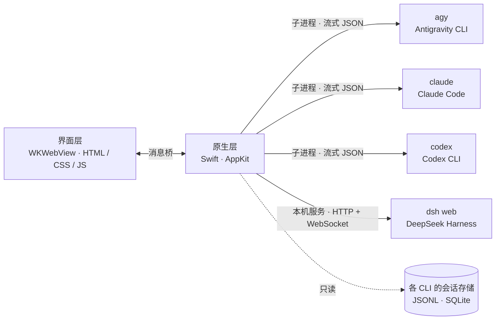

# 架构与开发

这份文档写给想读代码、改代码的人。使用说明见 [README](../README.md)。

## 工作原理



- 每次提问用一个对应的 CLI 进程，用它的双向协议对话（标准输入开着）：`claude -p --input-format stream-json`、`codex app-server`（JSON-RPC）、`agy acp`（Agent Client Protocol）。中途补充、停止、它提的问题、审批都走这条通道，这一轮答完就关掉输入让进程退出；CLI 版本太旧不支持时自动退回一问一答（`claude -p`、`codex exec`、`agy -p`）。事件流统一转换为「工作步骤 + 正文 + 改动文件」后推送到界面。
- 预热：用户开始打字、或上一轮刚答完时，按当前的设置（会话、模型、权限、工作空间）先起好一个进程、做完开场（Claude 的 initialize，Codex、Gemini 连会话也接上），等着；发送时设置对得上就接手它。每位最多留一个，设置变了或 10 分钟没用上就结束掉；预热之后那个会话又在别处（终端里）被接着聊过，也不接手，照常新起。
- 继续历史会话时使用各 CLI 自带的恢复方式（`--resume`、`thread/resume`、`session/resume`），会话始终保存在 CLI 原有的位置。
- 历史列表直接读取 CLI 自身的存储（Claude Code 的 JSONL、Codex 与 Antigravity 的 SQLite），以只读方式打开。
- 文档预览用 macOS 自带的 Quick Look（`qlmanage -p -o`，和访达里按空格看到的一样）把 Office 文件转成网页，RTF / ODT 用系统文本引擎转，再放进内置浏览器显示；转出来的网页加了禁止联网的内容安全策略，缓存在 `~/Library/Caches/AIPetHub/DocPreview`（按路径、修改时间和大小区分，最多保留 12 份、3 天）。

**实现要点**

| | 调用方式 | 默认权限（最高） | 历史会话来源 |
|---|---|---|---|
| Gemini | `agy acp`（退回：`agy -p … --output-format stream-json`） | `--dangerously-skip-permissions`；可选 `--mode accept-edits / plan` | 每个会话自己的 `conversations/<id>.db`（`steps` 表，protobuf），读不到时退回全文索引和 transcript |
| Claude | `claude -p --input-format stream-json --output-format stream-json --permission-prompt-tool stdio`（退回：不带后两个参数） | `--permission-mode bypassPermissions` | `~/.claude/projects/*/<id>.jsonl` |
| Codex | `codex app-server`（退回：`codex exec --json`） | `-c sandbox_mode="danger-full-access"` | `~/.codex/state_5.sqlite`、`thread_history_1.sqlite` 与 `sessions/**/rollout-*.jsonl` |
| DeepSeek | 常驻一个只听本机的 `dsh web` 服务（所有会话共用），`POST /api/<方法>` 发、两条 WebSocket 收事件 | 权限预设 `danger-full-access` | 通过服务的 `session.list` / `session.history` 读 |

DeepSeek 的接口没有公开文档，是照着 dsh 0.1.0-rc.7 实测的（`Sources/Agents/DeepSeekServer.swift` 开头有说明）；dsh 升级后可能要跟着调整。注意：在 AIPetHub 里给 DeepSeek 选模型和思考强度时，dsh 会把它记成自己以后新会话的默认值（写进 `~/.dsh/settings.yaml`），和它自带的网页界面行为一致。

- 改动卡片：CLI 的改文件工具报告的文件，加上工作目录是 git 仓库时回答前后 `git status` 的对比（命令改的文件也能列出，缺的 diff 用 `git diff` 补上）。
- 「停止」先通过协议请它中断（`interrupt` / `turn/interrupt` / `session/cancel`），4 秒内没退出再按进程树结束它以及它启动的命令；退出 App 时直接按进程树结束（预热着的进程也一起）。工作目录不存在时拒绝执行，不会退回主目录。
- 窗口只显示界面本身：拖入的文件变成路径插入输入框，意外的页面跳转一律拦截，网页进程崩溃时自动重新载入。
- 对话里的图片：Claude Code 记录里内嵌的 base64 图片块、Codex 的 `localImage`（文件不在了就取 rollout 里同一路径的 `input_image`）、消息文字里的图片路径。随历史只发缩略图（长边 640 像素，带透明的 480，只缓存在内存里），点开时再从文件或会话记录里读原图。

## 项目结构

```
ai-pet-hub/
├── build.sh                 构建、签名与安装
├── Sources/                 原生代码（Swift）
│   ├── App/                 窗口、菜单、网页 ↔ 原生的消息桥（Bridge.swift）、启动和退出、自动化测试入口
│   ├── Runtime/             一次提问的流程（AskFlow）、CLI 进程（CLIProcess）、交互式回答的共用部分（LiveTurn）、
│   │                        预热（Prewarm）、git 改动对比（GitChanges）、历史会话的分发（Conversations）
│   ├── Agents/              各位的实现（DeepSeek 是 DeepSeekServer + DeepSeekRun），其余每位三个文件：
│   │                        *Run（找命令、拼参数、退回一问一答）、*Live（交互式回答）、*History（读历史会话）
│   ├── Parsing/             各家 CLI 的事件 → 统一的「工作步骤 + 正文 + 改动文件」（TurnBuilder）
│   └── Preview/             文件预览、内置浏览器（Browser）和给智能体用的工具（BrowserTools）、
│                            文档预览、对话里的图片、搜索正文和 @ 文件
├── web/                     界面（网页）
│   ├── index.html
│   ├── css/                 base / sidebar / chat / preview / markdown / composer / popover / stage / live
│   ├── js/
│   │   ├── core/            config（各位的配置）、state（状态和本地存储）、logic（纯逻辑，有单元测试）、markdown
│   │   ├── chat/            messages、turn（一轮回答）、live-steps 和 stream（进行中的显示）、
│   │   │                    live（排队、插队、审批 / 提问 / 计划卡片）、changes（全部改动）、send
│   │   ├── ui/              menus（模型和权限菜单）、history（左栏）、layout（拖动）、composer（附件、/ 和 @、预热）
│   │   ├── stage/           pets（角色舞台）
│   │   ├── preview/         editor（预览面板）
│   │   ├── native-callbacks.js   原生调过来的回调
│   │   └── boot.js          启动
│   ├── sprites/             角色动画帧（PNG 原图；打包时转成 WebP）
│   ├── rig/                 骨骼动画的运行库（src/ 是源码，pet-rig.js 是打包结果）和三位的模型（大肥鱼没有骨骼，全用逐帧）
│   └── vendor/              highlight.js、KaTeX、three.js
└── tools/
    ├── test.sh              离线测试：解析器、Markdown 渲染、界面逻辑、脚本语法（不需要 CLI）
    ├── parsertest.swift / test-markdown.mjs / test-logic.mjs   上面三类测试的用例
    ├── selftest.swift       后端自测（需要真实 CLI 和会话）；livetest.swift 是其中交互式回答的部分
    ├── uitest/              真实窗口的端到端测试脚本（run.sh）
    ├── sprites/             逐帧动作：生成、处理的脚本（见其中 README）
    ├── rig/                 分层美术 + 骨骼动画：出图、拆层、导出（见其中 README）
    └── make_icon.swift      生成应用图标
```

## 开发

改了解析器、Markdown 渲染或前端脚本之后，先跑离线测试（不需要 CLI、会话记录和网络，几十秒）；推送到 GitHub 时也会自动跑一遍并打包：

```bash
cd ai-pet-hub
tools/test.sh
```

后端还有一个不打开窗口的自测程序（`tools/test.sh` 已经把它编译到 `build/selftest`），用真实的 CLI 和会话验证历史读取与进程管理：

```bash
./build/selftest list                       # 读取三个智能体的历史会话并打开第一条
tools/uitest/run.sh claude e2e-live.js       # 真实窗口的端到端测试（先 ./build.sh）：开一个完全透明、点不到的窗口（屏幕上看不见），在界面里自动操作，网页 ↔ 原生 ↔ CLI 全是真的；另有 e2e-browser.js、e2e-stream.js、e2e-jump.js、e2e-misc.js、e2e-more.js
./build/selftest live claude <空目录> [模型]  # 交互式：来问→允许 / 拒绝、中途补充、停止、接着同一会话问、预热（gpt、gemini 同理；预热那项要 AIPETHUB_PREWARM=1）
./build/selftest proc                       # 子进程输出、停止与超时处理
./build/selftest e2e claude <空目录>         # 真实调用：建文件 → 同一会话追问 → 中途停止
./build/selftest orphan claude <空目录> 42   # 命令运行中停止，检查没有残留进程
./build/selftest models claude <空目录>      # 模型菜单里的每个模型发一句（只读模式）
./build/selftest deleteproject claude <目录> # 删除某个工作目录里的全部会话（测试后清理）
./build/selftest docpreview <文档>…           # Word / Excel / PPT 转成预览网页（第二次应命中缓存）
./build/selftest docbrowser <docx> <临时目录> # 内置浏览器里的文档预览：地址栏、刷新重新生成、坏文件、停止、后退
```

