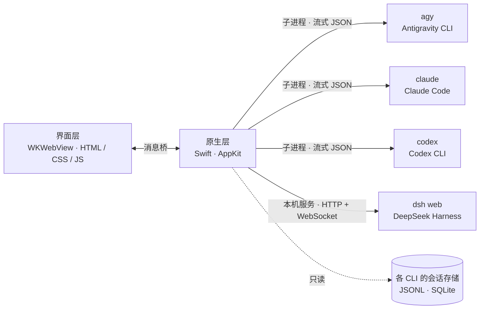

# 架构与开发

这份文档写给想读代码、改代码的人，只写机制和去哪儿找；具体行为写在实现它的那个文件开头。使用说明见 [README](../README.md)。

## 工作原理



- **一次提问一个 CLI 进程，走它的双向协议。** 中途补充、停止、审批、它提的问题都要在回答进行中来回传，只有标准输入开着的协议（stream-json、app-server、ACP）做得到；CLI 太旧时退回一问一答。共用部分在 `Runtime/LiveTurn.swift`，各位的在 `Agents/*Live.swift`。
- **DeepSeek 例外：常驻一个 `dsh web`。** dsh 的无界面模式只能一问一答、看不到过程，完整能力只在网页模式的服务里；接口没有公开文档，是照 dsh 0.1.0-rc.7 实测的（`Agents/DeepSeekServer.swift` 开头）。
- **历史只读 CLI 自己的存储，会话始终留在 CLI 原来的位置**，续聊用各 CLI 自带的恢复方式。代价是同一会话可能同时被别的程序写，四位各有对策：Claude 在别处开着就分叉（`ClaudeSessions.swift`），Codex 认写锁（`CodexRun.swift`、`CodexProjection.swift`），Gemini 查谁持着会话库（`GeminiSessions.swift`、`GeminiStore.swift`），dsh 只认内存所以比对日志指纹、持跨实例写锁（`DeepSeekSessionFiles.swift`）。
- **各家事件统一成一个模型**（`Parsing/TurnBuilder.swift`：工作步骤 + 正文 + 改动文件），界面只认这一种。一轮的结局原生和网页各判一处：原生是 `TurnBuilder.swift` 的 `restoredEndingText` 和 `Conversations.swift` 的 `rememberReplyEnding`，网页是 `web/js/core/logic.js`。
- **改动卡片 = 改文件工具报的文件 + 回答前后的 git 快照之差。** CLI 不报命令改的文件，只能自己比（`Runtime/GitChanges.swift`、`web/js/chat/changes.js`）。
- **停止先走协议中断，4 秒后按进程树结束。** CLI 收到中断可能自己先退、留下它起的命令，所以中断前先记下子孙进程（`Runtime/RunCLI.swift`、`CLIProcess.swift`）。
- **几个窗口、几个实例可以同时开。** WebKit 的网页存储不在实例之间实时同步，所以草稿、改动、未读都是读写前重读、只改本窗口动过的；删除和分组变化经 macOS 分布式通知告诉其他实例。

**实现要点**

| | 调用方式 | 默认权限（最高） | 历史会话来源 |
|---|---|---|---|
| Gemini | `agy acp`（退回：`agy -p … --output-format stream-json`） | `--dangerously-skip-permissions`；可选 `--mode accept-edits / plan` | 每个会话自己的 `conversations/<id>.db`（`steps` 表，protobuf；桌面版留成状态 5 的工具步骤按 transcript 的最终状态显示），读不到时退回全文索引和 transcript |
| Claude | `claude -p --input-format stream-json --output-format stream-json --permission-prompt-tool stdio`（退回：不带后两个参数） | `--permission-mode bypassPermissions` | `~/.claude/projects/*/<id>.jsonl` |
| Codex | `codex app-server`（退回：`codex exec --json`） | `-c sandbox_mode="danger-full-access"` | `CODEX_HOME`（未设置时为 `~/.codex`）下的 `state_5.sqlite`、`thread_history_1.sqlite` 与 `sessions/**/rollout-*.jsonl[.zst]` |
| DeepSeek | 常驻一个只听本机的 `dsh web` 服务（所有会话共用），`POST /api/<方法>` 发、两条 WebSocket 收事件 | 权限预设 `danger-full-access` | 通过服务的 `session.list` / `session.history` 读 |

## 按主题找代码

细节都在第二列文件的开头注释里；最后一列是改这里时必须一起动的东西。

| 主题 | 去哪儿找 | 一起动的 |
|---|---|---|
| 一轮回答、补充、提问卡、初始化期限 | `Runtime/LiveTurn.swift`、`Agents/*Live.swift`、`web/js/chat/live.js` | CLI 新加的回调四位都要接上或回「不支持」 |
| 预热 | `Runtime/Prewarm.swift`；Gemini 续接见 `GeminiSessions.swift`，Codex 写锁见 `CodexRun.swift` | 网页打字触发在 `web/js/ui/composer.js` 的 `prewarm` |
| 草稿归属、附件接收 | `web/js/ui/drafts.js` | 原生退回原问在 `Runtime/AskFlow.swift`、`LiveTurn.swift` |
| 历史读取、来源、删除 | `Runtime/Conversations.swift` 分发，`Agents/*History.swift` 各读各的 | 网页撤下统一走 `history.js` 的 `removeConversations` |
| 左栏列表、任务会话分组、刷新 | `web/js/ui/history.js`（`isTaskConversation`、`refreshHistory`）、`history-rows.js`、`project-delete.js` | 删除项目和侧栏用同一套分组规则 |
| 历史同步到页面 | `web/js/core/logic.js` 的 `planHistoryRows`、`historyAskMatches`；`web/js/chat/message-sync.js` | `tools/test-session-logic.mjs`、`test-logic.mjs` |
| 结局补记 | `Runtime/Conversations.swift`（`rememberReplyEnding`）、`Parsing/TurnBuilder.swift`、各 `*History.swift` | 网页判定在 `logic.js` |
| 在别处运行的会话 | `web/js/chat/elsewhere.js`；Codex 写锁和分叉见 `CodexProjection.swift` | 原生把末轮状态随历史一起发 |
| 改动卡片 | `Runtime/GitChanges.swift`；`web/js/chat/changes.js`（`matchTurnExtras`、`renderChangeTurn`） | 认领规则是 `logic.js` 的 `matchExtras`，和历史同步共用 `historyAskMatches` |
| 正文搜索 | `Preview/ConversationSearch*.swift` | 改可见文字规则递增 `ConversationSearchText.version`，改缓存格式递增 `ConversationSearchDiskCache.formatVersion` |
| 上下文用量、剩余用量、模型菜单 | `Agents/HistoryContext.swift`、`Agents/Usage.swift`、`web/js/ui/model-menu.js`、`usage-panel.js` | — |
| MCP 表单和链接 | `Agents/MCPElicitation.swift` | Claude、Codex 两边的外壳 |
| DeepSeek 服务、事件流、重连 | `Agents/DeepSeekServer.swift`、`DeepSeekServerCalls.swift`、`DeepSeekSessionFiles.swift` | 假服务 `tools/fixtures/fake-dsh.py` |
| DeepSeek 一次回答、要人答的请求、分页 | `Agents/DeepSeekLive.swift`、`DeepSeekRequests.swift`、`DeepSeekHistory.swift`；结束事件 `Parsing/DeepSeekEvents.swift` 的 `finishedTurn` | 实时和历史共用同一个结束判断 |
| Codex 归档、分叉、投影 | `Agents/CodexArchive.swift`、`CodexProjection.swift`、`CodexRollout.swift`、`CodexTurns.swift` | — |
| Gemini 桌面版和会话库 | `Agents/GeminiStore.swift`、`GeminiSessions.swift`、`GeminiDesktopIndex.swift`、`Parsing/GeminiDatabase.swift` | — |
| 对话里的图片 | `Preview/SentImages.swift`（发送时冻结）、`ChatImages.swift`、`ChatThumbnails.swift`、`ChatImageOriginals.swift` | 网页的附件来源是 `message-sync.js` 的 `sentAttachments` |
| 内置浏览器、表单、文档预览 | `Preview/Browser.swift`、`BrowserForms.swift`、`BrowserTools.swift`、`DocPreview.swift` | — |
| 网页重载后接回 | `App/Bridge.swift` 的 `pageReady`、`App/Navigation.swift` | 网页一侧在 `web/js/boot.js` |
| 只给测试用的开关 | `Runtime/TestHooks.swift` | 别的文件不加 `#if HUB_SELFTEST` |

## 项目结构

```
ai-pet-hub/
├── build.sh                 打包（逐帧素材装了 cwebp 就转 WebP）；--install 装到 /Applications
├── Sources/                 原生代码（Swift），每个文件开头说明它管什么
│   ├── App/                 main（入口）、AppDelegate、AppViews（窗口和视图）、Bridge（网页 ↔ 原生消息桥）、Navigation（拦跳转、崩溃重载）、
│   │                        MainMenu、WindowChrome（红绿灯、全屏、前后台）、DockAttention（Dock 提醒）、Helpers、UITest（真实窗口测试入口）
│   ├── Runtime/             AskFlow（一次提问）、CLIProcess（进程和进程树）、RunCLI（runCLI / runTool / 子进程环境 / 停止 / 退出）、
│   │                        LiveTurn（交互式回答共用部分）、Prewarm、GitChanges（改动快照）、Conversations（历史分发、结局补记）、Types、TestHooks
│   ├── Agents/              每位都有 *Run（找命令、拼参数、握手、预热、退回一问一答）、*Live（交互式回答）、*History（读历史），另有：
│   │                        Claude：ClaudeSessions（外部会话与分叉）
│   │                        Codex：CodexTurns（归成一问一答）、CodexRollout（新旧事件）、CodexProjection（投影补齐、分叉、写锁）、CodexArchive、CodexRetry（限流提示）
│   │                        Gemini：GeminiStore（CLI / 桌面两个来源）、GeminiSessions（持库检查）、GeminiDesktopIndex（桌面版索引）
│   │                        DeepSeek：DeepSeekServer（常驻服务、事件流）、DeepSeekServerCalls（上行调用）、DeepSeekSessionFiles（日志指纹、写锁）、DeepSeekRequests（要人答的请求）
│   │                        共用：HistoryContext（上下文用量）、Usage（剩余用量）、MCPElicitation、AgentSetup（找 CLI、验证）
│   ├── Parsing/             各家事件 → TurnBuilder：ClaudeEvents、CodexEvents、GeminiEvents、DeepSeekEvents；GeminiDatabase（会话库 protobuf）
│   └── Preview/             FilePreview、Browser、BrowserForms、BrowserTools（给智能体的浏览器工具）、DocPreview、
│                            SentImages、ChatImages、ChatThumbnails、ChatImageOriginals、ConversationSearch（+ History / Text / Disk / Revision）
├── web/                     界面（网页）；index.html 里脚本的加载顺序有讲究，见各 js 文件开头
│   ├── css/                 base（变量）/ sidebar / chat / preview / markdown / composer / popover / stage / live，后加的观感层 squircle / feel / craft / finish
│   ├── js/core/             config、state、logic（纯逻辑，有单元测试）、markdown、spring
│   ├── js/chat/             messages、message-sync、turn、live-steps、stream、live、changes、send、elsewhere、fork、jump
│   ├── js/ui/               menus、model-menu、usage-panel、history、history-rows、project-delete、layout、drafts、composer、agents、welcome、effort-flow
│   ├── js/stage/            pet、pet-motion、pet-reactions、pet-sleep、sprites
│   ├── js/preview/          pane、files、diff、highlight、browser
│   ├── js/native-callbacks.js、boot.js   原生调过来的回调、启动
│   ├── sprites/             逐帧动画（PNG 原图；打包时转 WebP）
│   ├── rig/                 骨骼动画运行库（src/ 源码，pet-rig.js 打包结果）和三位的模型（大肥鱼没有骨骼，全用逐帧）
│   ├── lab/                 骨骼动画调试页 layer-demo.html、compare.html（不打进 App）
│   └── vendor/              highlight.js、KaTeX、three.js（见其中 README）
└── tools/
    ├── test.sh              离线测试唯一入口
    ├── tests/               Swift 测试，编译成 build/selftest：selftest.swift（子命令清单）、offline.swift（组表、分片耗时）、
    │                        support.swift（公共辅助，写新辅助前先在这里找）、selftest-commands.swift（排查用的手动子命令）、livetest.swift，其余按主题一组一文件
    ├── test-*.mjs           Node：Markdown、界面逻辑、输入框与独立模块、会话同步
    ├── test-deepseek.py     DeepSeek 场景并行跑，各起一个假服务
    ├── test-suspend.py      暂停 / 恢复
    ├── fixtures/            fake-cli.py（统一假 CLI）、fake-dsh.py（假 dsh 服务）、dsh-turn.jsonl（实录的一轮）、gitconfig-lfs（模拟装了 Git LFS）
    ├── uitest/              真实窗口测试：run.sh（单跑，开头有套件清单）、run-suite.py（一次运行）、all.sh / all.py（全跑）、clean.sh、
    │                        lifecycle.py（停止和退出的外部观察）、clean-machine.sh（干净主目录跑 e2e-clean）、shot-readme.*（README 截图）、
    │                        assertions.js（makeSuite、until）、prelude.js（chatHarness 等公共代码）、e2e-*.js 和 e2e-frontend-modules/ 片段
    ├── sprites/、rig/       素材生成和处理（见其中 README）
    ├── export-public.sh     导出公开仓库（单次提交、去掉本机专用的东西）
    ├── make-dmg.sh          打 dmg 安装包
    └── make_icon.swift      生成应用图标
```

## 开发

改了代码之后先跑离线测试（不需要 CLI、会话记录和网络，约 45 秒）；推送到 GitHub 时也会自动跑一遍并打包。调试时用 `tools/test.sh --only 词` 只跑离线主体里名字含这个词的组，提交前再全跑：

```bash
cd ai-pet-hub
tools/test.sh
```

它把产品源码和 `tools/tests/` 编译成一个 `build/selftest`（只编译一次，先写到临时名再换上），然后**同时**跑下面这些（各步没有共享状态：临时目录带 UUID / pid、端口由系统分配、WebKit 不落盘），每步输出进自己的日志、最后汇总，失败的步骤把日志打出来。离线主体按各组实测耗时均衡拆成 8 份、核数少于 8 时按核数（CI 的 3 核机器拆 3 份；`AIPETHUB_OFFLINE_SHARD=i/N`，耗时表在 `offline.swift`）：

- `selftest offline`：事件解析、历史读取、进程生命周期、预热、用量 / git / 预览（`--only` 只筛这一步）
- `selftest preview-bridge`：预览和网页桥（无窗口）
- `tools/test-suspend.py`：暂停 / 恢复
- `tools/test-deepseek.py`：DeepSeek 的生命周期，每个场景起一个假服务（`fixtures/fake-dsh.py`）
- `selftest preview-fixes git|browser|docs`：本轮改动的快照、内置浏览器和搜索、文档转换，分三步跑；git 段再在全局带 Git LFS 过滤器的配置下跑一遍
- Node：前端脚本语法、Markdown、界面逻辑、输入框和独立模块、会话同步

`--only` 之外的几步怎么单跑写在 `tools/test.sh` 开头；`build/selftest` 的全部子命令（含要用真实 CLI 和会话排查问题的）只列在 `tools/tests/selftest.swift` 开头。

等待的写法（用户 2026-11-18 定）：等某件事发生，一律用各文件等待函数的默认上限，调用处不写数字。离线是 `tools/tests/support.swift` 的 `testWaitLimit`（`AIPETHUB_TEST_WAIT`，默认 60 秒；钩子里卡位等放行用更长的 `testHoldLimit`）。窗口是 `tools/uitest/assertions.js` 的 `until(条件, '说明')`，默认上限 `WAIT`（`run-suite.py` 注入，`UITEST_WAIT`，默认 240 秒，套件总上限 560 秒要比它加最慢一套正常耗时长）。条件一成立就返回，正常路径不多等；假进程的坏路径要挂得比上限久，否则会靠自然结束蒙混过关。断言某事没发生，用 TestHooks 卡位或比两件事的先后，不靠睡一段再看。真正测速度的断言名字以「性能断言」开头，比值取多次中的最小值；机器负载高时它失败，先重跑确认再判断是不是回归。

真实窗口的测试在 `tools/uitest/`，每套都由断言判对错，套件清单和各自测什么见 `run.sh` 开头。`e2e-frontend-modules`、`e2e-session-sync`、`e2e-ui` 不用 CLI；其余用真的 CLI（假 CLI 只模仿写测试时的协议，CLI 升级后只有真跑才发现得了），`e2e-stream` 用假 CLI 检查四位正文逐帧增长。`all.sh` 默认 26 套、最多 10 套同时跑（瓶颈是最慢的 `e2e-live`；为什么限 10 见 `all.py`），每次用自己的 App 副本、会话清单和结果目录，跑完自动清掉这次的测试会话；耗时长的套件按耗时拆开，共用的发问、读历史等准备代码在 `prelude.js` 的 `chatHarness`：

```bash
./build.sh                                  # 窗口测试用的是 build/ 里的包，先打包（不带 --install）
tools/uitest/all.sh                         # 全跑，默认 Claude、Codex、Gemini + DeepSeek；有失败时退出码非零
tools/uitest/all.sh claude                  # 只跑 Claude 的真实 CLI 套件（加 DeepSeek、不用 CLI 的三套和四位 e2e-stream）
tools/uitest/run.sh claude e2e-live.js      # 单跑一套
tools/uitest/run.sh gemini e2e-stream.js    # 四位均可：假 CLI 检查正文逐帧增长，包含收尾和外部同步
tools/uitest/clean.sh                       # 清掉单跑留下的会话
```
